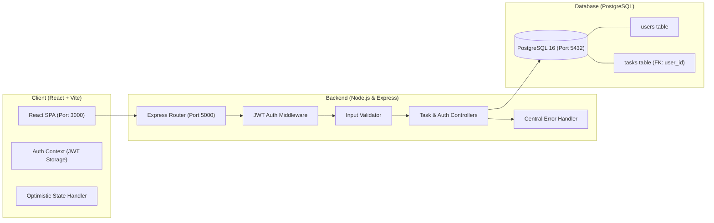

# ⚡ Full Stack Task Manager (React • Node.js • PostgreSQL • Docker • JWT)

[](https://react.dev/)
[](https://nodejs.org/)
[](https://www.postgresql.org/)
[](https://jwt.io/)
[](https://www.docker.com/)

A lightweight, production-ready Full Stack application built to practice and showcase **secure backend architecture**, **relational database modeling**, and **clean RESTful API design**.

---

## 🌟 Key Highlights

- **Secure REST API**: Built with JWT authentication, salted password hashing (`bcrypt`), declarative request validation (`express-validator`), and centralized operational error handling.
- **Relational Database Architecture**: PostgreSQL relational schema modeling a 1-to-many relationship between Users and Tasks with foreign keys, cascade deletes, status constraints, and optimized B-Tree indexes.
- **Containerized Deployment**: Complete multi-container orchestration using `docker-compose` (PostgreSQL service + Node.js API + Nginx-powered React SPA) for single-command deployment across any environment.
- **Seamless Frontend Integration**: Modern React frontend with optimistic UI updates (instant checkbox toggle and task deletion with automatic rollback on network failure), loading skeletons, and centralized error banners.

---

## 🏗️ System Architecture



---

## 🗄️ Relational Database Schema

```sql
-- Users Table
CREATE TABLE users (
    id SERIAL PRIMARY KEY,
    name VARCHAR(100) NOT NULL,
    email VARCHAR(255) UNIQUE NOT NULL,
    password_hash VARCHAR(255) NOT NULL,
    created_at TIMESTAMP WITH TIME ZONE DEFAULT CURRENT_TIMESTAMP,
    updated_at TIMESTAMP WITH TIME ZONE DEFAULT CURRENT_TIMESTAMP
);

-- Tasks Table
CREATE TABLE tasks (
    id SERIAL PRIMARY KEY,
    user_id INTEGER NOT NULL REFERENCES users(id) ON DELETE CASCADE,
    title VARCHAR(255) NOT NULL,
    description TEXT,
    priority VARCHAR(20) DEFAULT 'medium' CHECK (priority IN ('low', 'medium', 'high')),
    is_completed BOOLEAN DEFAULT FALSE,
    due_date DATE,
    created_at TIMESTAMP WITH TIME ZONE DEFAULT CURRENT_TIMESTAMP,
    updated_at TIMESTAMP WITH TIME ZONE DEFAULT CURRENT_TIMESTAMP
);

-- Performance Indexes
CREATE INDEX idx_tasks_user_id ON tasks(user_id);
CREATE INDEX idx_users_email ON users(email);
CREATE INDEX idx_tasks_status ON tasks(user_id, is_completed);
```

---

## 📡 REST API Specification

### Authentication Endpoints
| Method | Endpoint | Description | Auth Required |
|---|---|---|---|
| `POST` | `/api/auth/register` | Register new user account | No |
| `POST` | `/api/auth/login` | Authenticate with email/password and obtain JWT | No |
| `GET` | `/api/auth/profile` | Get current authenticated user profile | **Yes** (Bearer Token) |

### Task Management Endpoints
| Method | Endpoint | Description | Auth Required |
|---|---|---|---|
| `GET` | `/api/tasks` | Get all tasks (supports `?status=`, `?priority=`, `?search=`) | **Yes** |
| `GET` | `/api/tasks/stats` | Get metrics summary (total, completed, pending, high priority) | **Yes** |
| `POST` | `/api/tasks` | Create a new task | **Yes** |
| `PUT` | `/api/tasks/:id` | Update task details or toggle completion status | **Yes** |
| `DELETE` | `/api/tasks/:id` | Delete task by ID | **Yes** |

---

## 🚀 Quickstart & Setup

### Option 1: Docker (Recommended - One Command)

Prerequisites: [Docker Desktop](https://www.docker.com/products/docker-desktop/)

```bash
# Clone the repository
git clone https://github.com/your-username/full-stack-task-manager.git
cd full-stack-task-manager

# Build and start all services (PostgreSQL, Backend, Frontend)
docker compose up --build
```

- **Frontend Client**: `http://localhost:3000`
- **Backend API**: `http://localhost:5000`
- **Database**: `localhost:5432`

---

### Option 2: Local Development Setup

Prerequisites: [Node.js v18+](https://nodejs.org/) and a running [PostgreSQL](https://www.postgresql.org/) instance.

#### 1. Setup Backend:
```bash
cd server
npm install
cp .env.example .env
# Edit .env with your PostgreSQL credentials
npm run dev
```

#### 2. Setup Frontend:
```bash
cd ../client
npm install
npm run dev
```
Open `http://localhost:3000` in your browser.

---

## 🛡️ Security & Engineering Best Practices

1. **Password Security**: Passwords are never stored in plaintext. They are salted and hashed using `bcrypt` (10 rounds).
2. **Stateless JWT Authorization**: Protected routes utilize Bearer tokens validated against a cryptographic secret, maintaining stateless horizontal scalability.
3. **Scoped Resource Queries**: All SQL operations enforce `WHERE user_id = $userId` to guarantee that users cannot view, edit, or delete another user's records (preventing IDOR vulnerabilities).
4. **Input Sanitization & Validation**: Express-validator middleware rejects malformed payloads, verifies email formats, and constrains field lengths before hitting controllers.
5. **Centralized Error Handling**: Custom `AppError` class handles operational exceptions and masks raw database stack traces in production.
6. **Optimistic UI with Rollback**: When a user marks a task completed or deletes an item, the UI updates instantly. If the network or server rejects the operation, the client state automatically rolls back and surfaces a descriptive notification.

---

## 📂 Project Structure

```
├── docker-compose.yml       # Multi-container orchestration
├── server/
│   ├── src/
│   │   ├── config/db.js     # PostgreSQL pool & auto-migration
│   │   ├── controllers/    # Business logic (auth, tasks)
│   │   ├── middleware/     # JWT auth, validation, centralized error handling
│   │   ├── routes/         # Express endpoint definitions
│   │   ├── db/schema.sql   # Relational DDL schema & indexes
│   │   ├── app.js          # Express app configuration
│   │   └── index.js        # Server listener
│   ├── Dockerfile
│   └── package.json
├── client/
│   ├── src/
│   │   ├── api/client.js   # Fetch wrapper with JWT headers
│   │   ├── components/     # UI components (TaskForm, TaskList, StatsCards, Navbar, AuthForm)
│   │   ├── context/        # React AuthContext
│   │   ├── index.css       # Clean minimalist dark mode design system
│   │   └── App.jsx         # Optimistic UI & state management
│   ├── nginx.conf          # Nginx reverse proxy & static SPA server
│   ├── Dockerfile
│   └── package.json
└── README.md
```

---

## 📄 License
MIT License. Feel free to use this as a reference or portfolio boilerplate!
